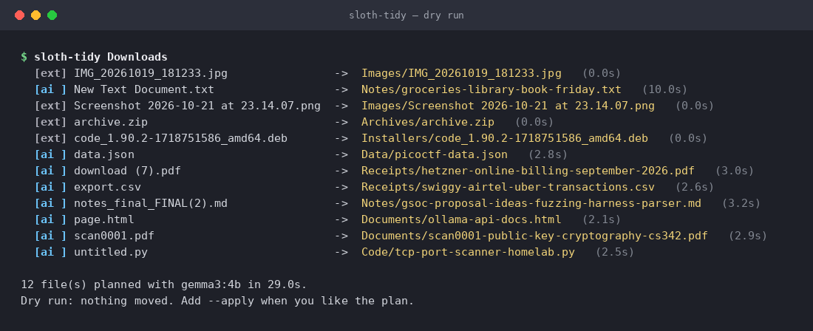
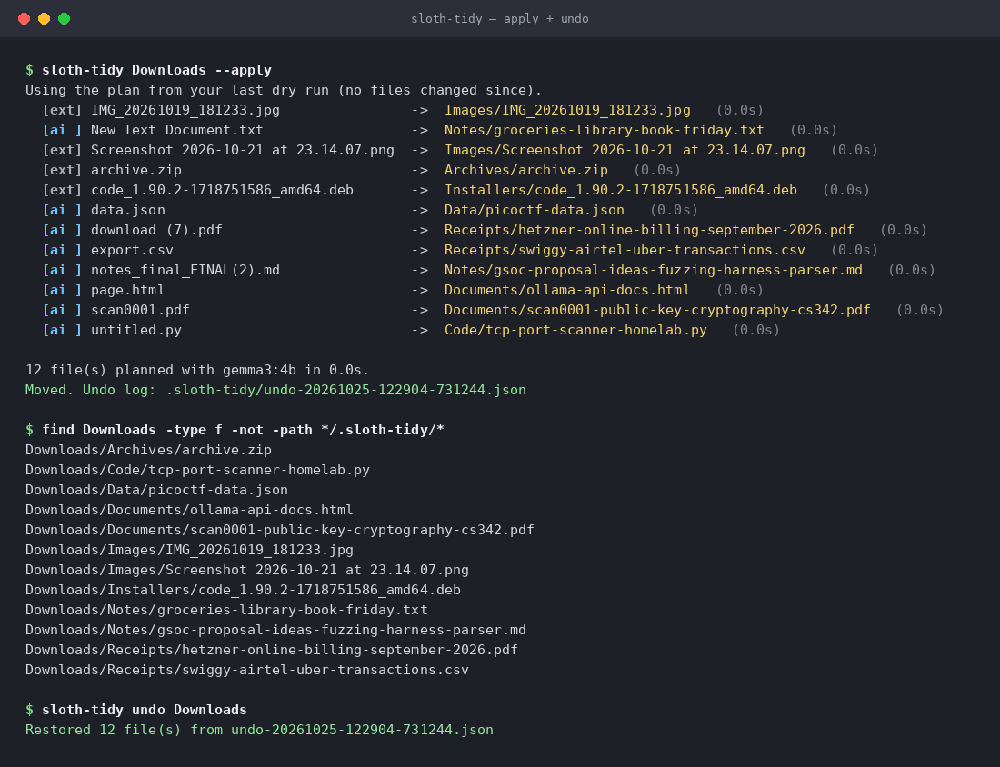
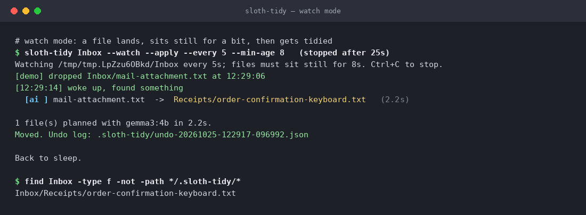

# sloth-tidy 🦥

A lazy, local-first folder tidier. Point it at your messy `Downloads`, and a small
open-weight model (Gemma 3, running on your own machine through [Ollama](https://ollama.com))
reads the start of each file, picks a category folder, and suggests a filename that
says what the file actually is.

```
download (7).pdf         ->  Receipts/hetzner-online-billing-september-2026.pdf
untitled.py              ->  Code/tcp-port-scanner-homelab.py
notes_final_FINAL(2).md  ->  Notes/gsoc-proposal-ideas-fuzzing-harness-parser.md
```

## Demo

Real output from `demo/demo-output.txt` (Gemma 3 4B on CPU through Ollama).

**Dry run:** `[ai ]` = the model read the file, `[ext]` = extension rule.



**Apply, then undo:**



**Watch mode:** a file lands, sits still, gets filed.



> **Challenge note:** this project was started and completed during the DEV
> Hacktoberfest Open-Source AI Challenge, Week 3 ("Slow and Steady"),
> October 19 to 25, 2026. Any commits after the deadline will be listed here.

## Why it's safe to leave alone

- **Dry run by default.** Without `--apply` nothing moves. The dry run's plan is saved,
  and `--apply` reuses it if no file changed, so the plan you read is the plan that runs.
- **Undo.** Every applied run writes `.sloth-tidy/undo-*.json`; `sloth-tidy undo DIR`
  puts everything back and removes category folders it emptied.
- **Never overwrites.** Name collisions become `name-2.ext`, `name-3.ext`. If a destination
  appears between planning and moving, that file is skipped. So is a file you deleted or
  moved in the meantime; everything else still moves and still gets an undo log.
- **Localhost only.** The Ollama URL must resolve to a loopback address, otherwise the
  CLI refuses to start. File contents never leave the machine.
- **Doesn't guess blind.** Files it can't read (images, archives, installers) are sorted by
  extension and keep their name. A small model shown only `IMG_2041.jpg` will happily
  invent "sunset over coastal cliffs"; extension rules don't lie.
- **Works without the model.** If Ollama isn't running, it falls back to extension rules.
- **Leaves things alone:** hidden files, sub-folders you already made, symlinks, and
  in-progress downloads (`.crdownload`, `.part`, ...).
- No dependencies beyond the Python standard library. PDF text comes from poppler's
  `pdftotext` if installed.

## Install

```bash
# 1. a local model
ollama pull gemma3:4b          # or gemma3:1b on a machine with little RAM

# 2. the tool
git clone https://github.com/Phantom9869/sloth-tidy && cd sloth-tidy
pip install -e .
```

## Use

```bash
sloth-tidy ~/Downloads                     # show the plan
sloth-tidy ~/Downloads --apply             # do it
sloth-tidy undo ~/Downloads                # changed my mind
sloth-tidy ~/Downloads --model gemma3:1b   # any Ollama model tag works
sloth-tidy ~/Downloads --no-model          # extension rules only
sloth-tidy ~/Downloads --watch --apply     # every 5 min, tidy files untouched for 10 min
```

Each line of the plan is tagged `[ai ]` (the model read it) or `[ext]` (extension rule),
with the seconds the model took.

## Try the demo

```bash
python demo/make_messy.py /tmp/demo/Downloads
sloth-tidy /tmp/demo/Downloads
```

`demo/run_demo.sh` reproduces the full run shown in `demo/demo-output.txt`.

## Tests

```bash
pip install pytest && pytest -q
```

The model is mocked in tests, so they run in well under a second without Ollama.

## How it works

1. `scanner.py` lists top-level files and grabs up to 600 characters of text
   (plain text, code, markdown, CSV/JSON, HTML with tags stripped, PDF via `pdftotext`).
2. `brain.py` sends name, size, the extension's usual category and the snippet to
   Ollama's `/api/chat` with a JSON schema in `format`, so the reply is always
   `{"category": ..., "name": ...}` with the category from a fixed list.
   Answers are validated; anything odd falls back to extension rules.
3. `planner.py` slugifies the name (max 6 words / 60 chars) and resolves collisions.
4. `mover.py` moves files with `os.rename` and writes the undo log.

## License

MIT. Gemma model weights are distributed by Google under the Gemma Terms of Use.
